# TP1 : Inversion de Contrôle et Injection de Dépendances

| | |
|---|---|
| **Faculté** | Faculté des Sciences de Sfax, Département d'informatique et des Communications |
| **Année universitaire** | 2026-2027 |
| **Matière** | Architecture MicroServices |
| **Filière** | MPSRCC1 |
| **Enseignantes** | Corinne Amel ZAYANI, Amal ABID |
| **Étudiante** | Damak Ameni |

## Objectifs

- Comprendre les concepts d'injection de dépendances (DI)
- Comprendre les concepts d'inversion de contrôle (IoC)
- Connaître le XML

Ce dépôt constitue le compte rendu du TP1. Il contient le code des quatre activités, les captures d'écran de l'exécution et les réponses aux questions du sujet.

---

## 0. Préparation de l'environnement

**Outils** : JDK 17 (Eclipse Temurin 17.0.20.1), IntelliJ IDEA, Maven, Spring 7.0.9.

### Vérification de Java

```
java -version
javac -version
```

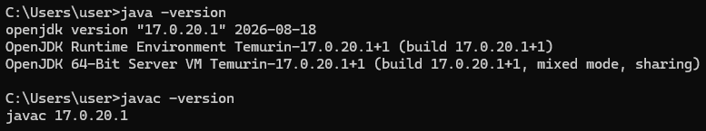

Java 17 est installé : `java` et `javac` affichent tous les deux la version 17.0.20.1.

### Création du projet Maven

Projet `TP1` créé dans IntelliJ : système de build Maven, JDK 17, GroupId `org.example`, ArtifactId `TP1`, sans code d'exemple, avec dépôt Git.

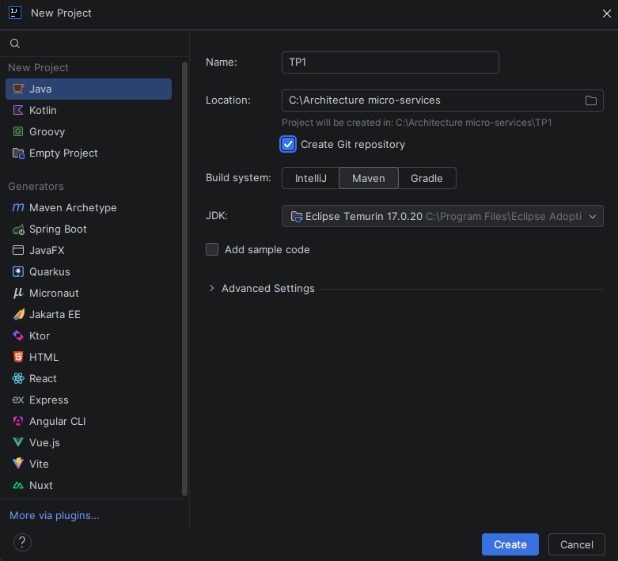

Les trois packages `dao`, `metier` et `presentation` ont été créés dans `src/main/java`, ainsi que le dossier `src/main/resources`.

### Dépendances Maven (`pom.xml`)

Les dépendances Spring Core, Spring Beans et Spring Context ont été ajoutées :

```xml
<properties>
    <maven.compiler.source>17</maven.compiler.source>
    <maven.compiler.target>17</maven.compiler.target>
    <project.build.sourceEncoding>UTF-8</project.build.sourceEncoding>
    <spring.version>7.0.9</spring.version>
</properties>

<dependencies>
    <dependency>
        <groupId>org.springframework</groupId>
        <artifactId>spring-core</artifactId>
        <version>${spring.version}</version>
    </dependency>
    <dependency>
        <groupId>org.springframework</groupId>
        <artifactId>spring-beans</artifactId>
        <version>${spring.version}</version>
    </dependency>
    <dependency>
        <groupId>org.springframework</groupId>
        <artifactId>spring-context</artifactId>
        <version>${spring.version}</version>
    </dependency>
</dependencies>
```

> La démarche proposait Spring 6.2.8. J'ai utilisé la version 7.0.9, qui fonctionne également avec JDK 17.

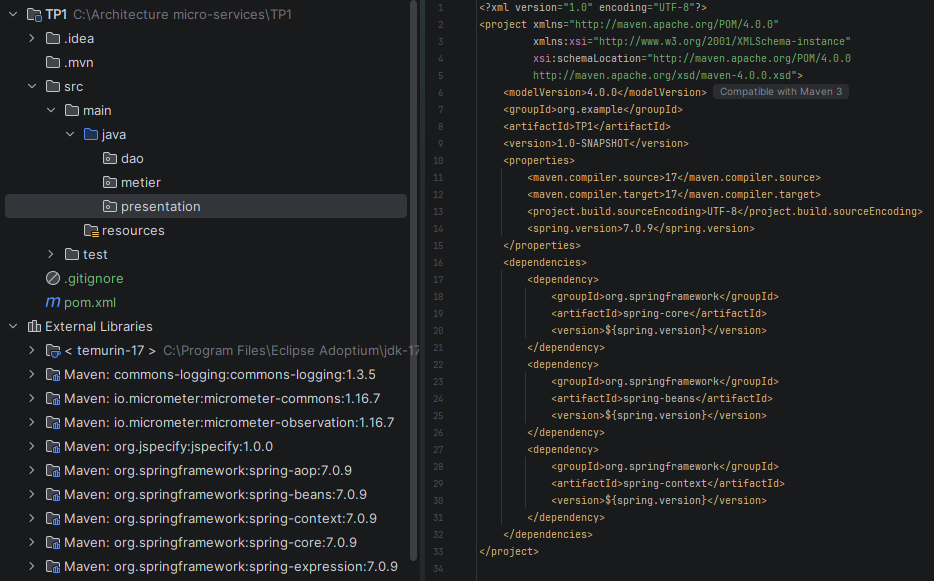

Après un clic sur *Load Maven Changes*, les bibliothèques Spring apparaissent dans *External Libraries*.

---

## Structure finale du projet

```
TP1
├── pom.xml
├── images/                      (captures d'écran)
└── src/main
    ├── java
    │   ├── dao            IDao.java, DaoIMP.java
    │   ├── metier         IMetier.java, MetierIMP.java
    │   └── presentation   PresentationStatique.java
    │                      PresentationDynamique.java
    │                      PresentationAvecSpring.java
    │                      PresentationAvecAnnotation.java
    └── resources          config.txt, config.xml
```

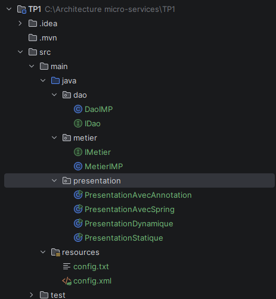

---

## Activité 1-1 : Injection de dépendances par instanciation statique

**Objectif** : explorer le couplage faible en utilisant l'injection de dépendances par instanciation statique.

### Code

**`dao/IDao.java`**

```java
package dao;

public interface IDao {
    double getValue();
}
```

**`dao/DaoIMP.java`**

```java
package dao;

public class DaoIMP implements IDao {
    @Override
    public double getValue() {
        return 3; // simulation d'un accès aux données
    }
}
```

**`metier/IMetier.java`**

```java
package metier;

public interface IMetier {
    double calcul();
}
```

**`metier/MetierIMP.java`**

```java
package metier;

import dao.IDao;

public class MetierIMP implements IMetier {

    private IDao dao; // dépendance vers l'INTERFACE : couplage faible

    @Override
    public double calcul() {
        double val = dao.getValue();
        return val * 7;
    }

    // Setter utilisé pour l'injection
    public void setDao(IDao dao) {
        this.dao = dao;
    }
}
```

**`presentation/PresentationStatique.java`**

```java
package presentation;

import dao.DaoIMP;
import dao.IDao;
import metier.IMetier;
import metier.MetierIMP;

public class PresentationStatique {
    public static void main(String[] args) {
        IDao dao = new DaoIMP();           // instanciation statique du DAO
        IMetier metier = new MetierIMP();  // instanciation statique du métier

        ((MetierIMP) metier).setDao(dao);  // injection de dépendance

        System.out.println(metier.calcul());
    }
}
```

### Exécution

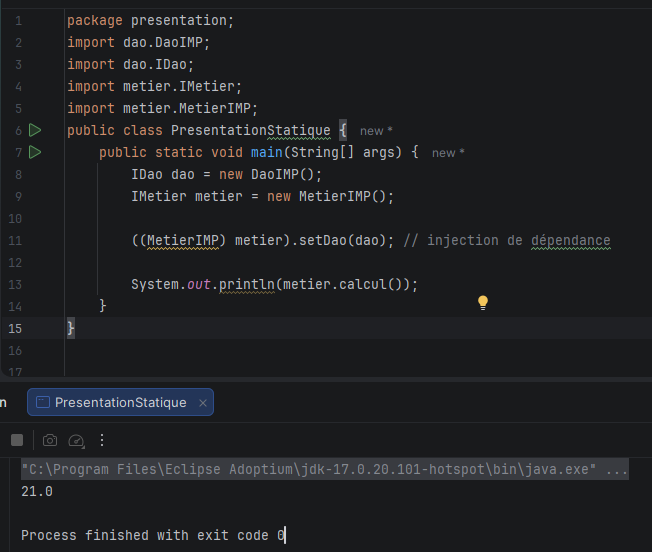

Résultat : `21.0` (3 × 7).

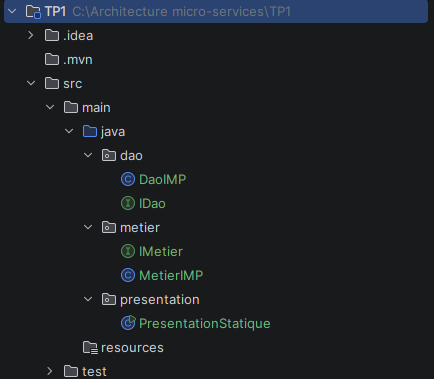

### Réponses aux questions

**Q9. Comment cela illustre-t-il le couplage faible ?**

- `MetierIMP` ne connaît que l'interface `IDao`, jamais la classe `DaoIMP`. Il dépend d'un contrat (`getValue()`), pas d'une implémentation.
- On peut créer `DaoMySQL`, `DaoWebService`, etc. qui implémentent `IDao` sans modifier une seule ligne de `MetierIMP` : l'application est fermée à la modification et ouverte à l'extension.
- C'est la classe `PresentationStatique` qui choisit l'implémentation et la fournit à `MetierIMP` via `setDao()` : c'est l'injection de dépendances.
- Sans cette injection, `dao` vaudrait `null` et `calcul()` lèverait une `NullPointerException`.

**Q10. Le principe d'Inversion de Contrôle est-il respecté ?**

Non, pas complètement. La classe `MetierIMP` ne crée pas elle-même son DAO : elle le reçoit de l'extérieur, ce qui est une forme d'injection de dépendances. Mais le contrôle de la création et de l'assemblage des objets reste entre les mains du programmeur : c'est `PresentationStatique` qui écrit `new DaoIMP()`, `new MetierIMP()` et appelle `setDao()`. Aucun mécanisme extérieur ne prend en charge ce travail, donc il y a injection de dépendances mais pas inversion de contrôle au sens complet.

**Q11. Que faudrait-il modifier pour que la présentation ne contrôle plus directement la création des objets ?**

Il faut déplacer la création et l'assemblage des objets hors du code de présentation : les noms des classes à utiliser sont décrits dans un fichier de configuration, et un mécanisme générique les instancie (réflexion, activité 1-2) ou un conteneur IoC comme Spring (activités 1-3 et 1-4) les crée et les relie. Le code de présentation se limite alors à demander l'objet dont il a besoin.

---

## Activité 1-2 : Injection de dépendances par instanciation dynamique

**Objectif** : explorer l'injection de dépendances à partir de noms de classes lus dans un fichier de configuration.

### Fichier `config.txt` (dans `src/main/resources`)

```
dao.DaoIMP
metier.MetierIMP
```

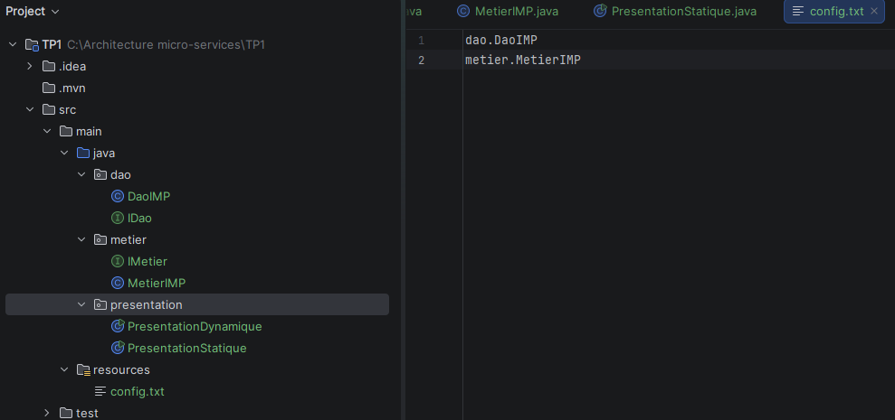

### Code : `presentation/PresentationDynamique.java`

```java
package presentation;

import dao.IDao;
import metier.IMetier;

import java.io.BufferedReader;
import java.io.InputStreamReader;
import java.lang.reflect.Method;

public class PresentationDynamique {
    public static void main(String[] args) throws Exception {

        // 1. Lire le fichier config.txt depuis le classpath
        BufferedReader br = new BufferedReader(
                new InputStreamReader(
                        PresentationDynamique.class
                                .getClassLoader()
                                .getResourceAsStream("config.txt")));

        String daoClassName = br.readLine();      // dao.DaoIMP
        String metierClassName = br.readLine();   // metier.MetierIMP
        br.close();

        // 2. Charger dynamiquement les classes et créer les instances
        Class<?> cDao = Class.forName(daoClassName);
        IDao dao = (IDao) cDao.getDeclaredConstructor().newInstance();

        Class<?> cMetier = Class.forName(metierClassName);
        IMetier metier = (IMetier) cMetier.getDeclaredConstructor().newInstance();

        // 3. Injection : appel dynamique de setDao(IDao) par réflexion
        Method setDao = cMetier.getMethod("setDao", IDao.class);
        setDao.invoke(metier, dao);

        // 4. Utilisation
        System.out.println(metier.calcul());
    }
}
```

### Exécution

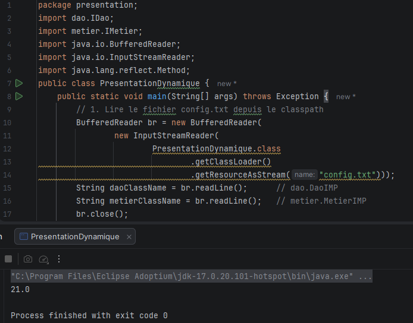

Résultat : `21.0`.

### Réponses aux questions

**Q7. Comment cela illustre-t-il l'injection de dépendances par instanciation dynamique ?**

Le code Java ne contient plus aucun `new DaoIMP()` ni `new MetierIMP()`. Les noms de classes sont lus dans `config.txt`, chargés avec `Class.forName()`, puis instanciés par réflexion. L'injection est faite elle aussi par réflexion : `getMethod("setDao", IDao.class)` retrouve le setter et `invoke()` l'appelle avec l'instance du DAO. Le code n'a même plus besoin de caster vers `MetierIMP`, donc il ne dépend plus des classes concrètes.

**Q8. En quoi cette approche se rapproche-t-elle davantage du principe IoC que l'activité 1-1 ?**

Dans l'activité 1-1, le choix des implémentations était écrit en dur dans le code de présentation. Ici, ce choix est déplacé dans un fichier de configuration, extérieur au programme : pour changer d'implémentation (par exemple `dao.DaoIMP2`), il suffit de modifier `config.txt`, sans toucher au code ni recompiler. Le programmeur ne décide plus directement des objets créés, c'est un mécanisme générique piloté par la configuration qui les crée et les assemble. C'est le principe de ce que fera Spring de manière industrialisée, mais il s'agit ici d'un petit conteneur écrit à la main, donc l'IoC reste partielle.

**Q9. Quels sont les avantages et les limites de cette solution ?**

*Avantages :*
- Changement d'implémentation sans modifier ni recompiler le code de présentation.
- Couplage faible : le code ne dépend que des interfaces.
- Application ouverte à l'extension (on peut ajouter de nouvelles implémentations).

*Limites :*
- Code de réflexion lourd et répétitif à écrire à la main.
- Les erreurs apparaissent à l'exécution (`ClassNotFoundException`, `NoSuchMethodException`, `NullPointerException` si le fichier est introuvable), pas à la compilation.
- Le format du fichier est fragile (l'ordre des lignes compte, une faute de frappe fait échouer le programme).
- Le nom du setter (`"setDao"`) est écrit en dur dans le code.
- Cette solution gère difficilement plusieurs dépendances, les cycles de vie des objets ou les dépendances en cascade : il faudrait réécrire un véritable conteneur.

---

## Activité 1-3 : Spring avec fichier de configuration XML

**Objectif** : explorer l'injection de dépendances avec le framework Spring et un fichier de configuration XML.

### Fichier `config.xml` (dans `src/main/resources`)

```xml
<?xml version="1.0" encoding="UTF-8"?>
<beans xmlns="http://www.springframework.org/schema/beans"
       xmlns:xsi="http://www.w3.org/2001/XMLSchema-instance"
       xsi:schemaLocation="http://www.springframework.org/schema/beans
       https://www.springframework.org/schema/beans/spring-beans.xsd">

    <!-- Bean DAO -->
    <bean id="dao" class="dao.DaoIMP"/>

    <!-- Bean métier, avec injection du DAO via le setter setDao() -->
    <bean id="metier" class="metier.MetierIMP">
        <property name="dao" ref="dao"/>
    </bean>
</beans>
```

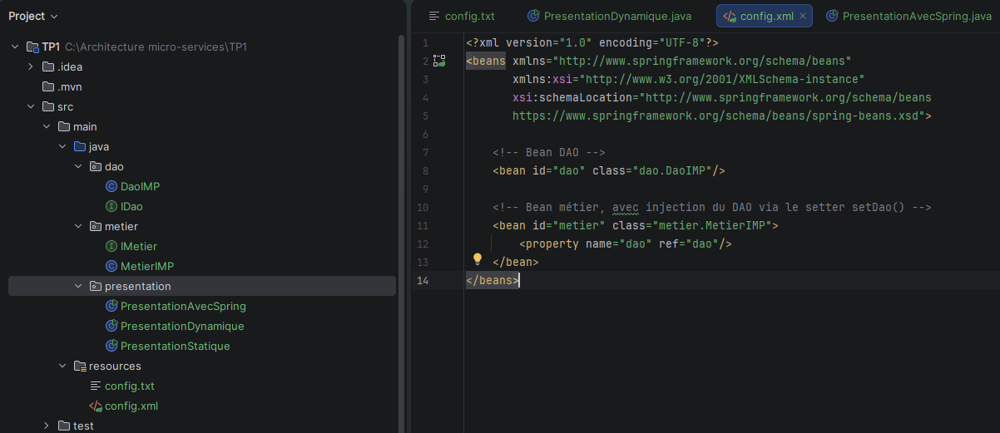

### Code : `presentation/PresentationAvecSpring.java`

```java
package presentation;

import metier.IMetier;
import org.springframework.context.ApplicationContext;
import org.springframework.context.support.ClassPathXmlApplicationContext;

public class PresentationAvecSpring {
    public static void main(String[] args) {
        ApplicationContext context =
                new ClassPathXmlApplicationContext("config.xml");

        IMetier metier = context.getBean("metier", IMetier.class);
        System.out.println(metier.calcul());
    }
}
```

### Exécution

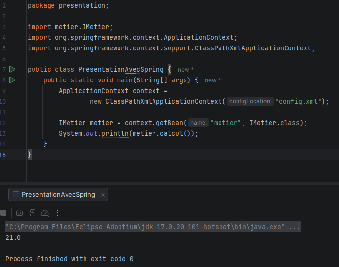

Résultat : `21.0`.

### Fonctionnement

1. `ClassPathXmlApplicationContext("config.xml")` crée le conteneur IoC : il lit le XML dans le classpath.
2. Spring instancie chaque `<bean>` par réflexion : `DaoIMP` puis `MetierIMP`.
3. Pour `<property name="dao" ref="dao"/>`, Spring appelle `setDao(...)` sur `MetierIMP` en lui passant le bean `dao` : c'est l'injection de dépendances par setter.
4. `getBean("metier", IMetier.class)` retourne l'objet déjà assemblé.

Pour que `<property name="dao">` fonctionne, `MetierIMP` doit avoir un setter `setDao` et un constructeur par défaut.

### Réponses aux questions

**Q6. Comparaison avec l'activité 1-2 en termes de gestion des dépendances**

| | Activité 1-2 (réflexion) | Activité 1-3 (Spring XML) |
|---|---|---|
| Contenu de la configuration | Seulement les noms des classes | Les beans **et** leurs dépendances (`<property ref>`) |
| Création des objets | Code écrit à la main (`Class.forName`, `newInstance`) | Réalisée par le conteneur Spring |
| Injection | Codée à la main (`getMethod`, `invoke`) | Déclarée dans le XML, effectuée par Spring |
| Ordre de création | Géré par le programmeur | Résolu automatiquement par le conteneur |
| Détection des erreurs | À l'exécution, au cas par cas | Au démarrage du conteneur, avec des messages explicites |

Avec Spring, les dépendances sont déclarées dans la configuration au lieu d'être programmées. Le code de présentation se réduit à charger le contexte et demander un bean.

**Q7. Différence entre création manuelle, création par réflexion et création par le conteneur Spring**

- **Création manuelle** (activité 1-1) : le programmeur écrit `new` et appelle lui-même `setDao()`. Simple, mais le choix des classes est figé dans le code (couplage fort entre la présentation et les implémentations).
- **Création par réflexion** (activité 1-2) : le programme lit les noms de classes dans un fichier, puis les instancie avec `Class.forName()`. Plus flexible, mais il faut écrire et maintenir soi-même le code de réflexion et d'injection.
- **Création par le conteneur Spring** (activité 1-3) : le conteneur lit la configuration, crée les beans, résout et injecte leurs dépendances. Le programmeur déclare ce qu'il veut, c'est Spring qui s'occupe du comment : c'est l'inversion de contrôle.

---

## Activité 1-4 : Spring avec annotations

**Objectif** : découvrir les annotations Spring pour l'injection de dépendances.

### Classes annotées

**`dao/DaoIMP.java`**

```java
package dao;

import org.springframework.stereotype.Repository;

@Repository
public class DaoIMP implements IDao {
    @Override
    public double getValue() {
        return 3;
    }
}
```

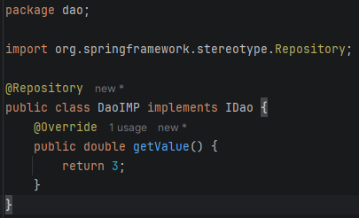

**`metier/MetierIMP.java`**

```java
package metier;

import dao.IDao;
import org.springframework.beans.factory.annotation.Autowired;
import org.springframework.stereotype.Service;

@Service
public class MetierIMP implements IMetier {

    @Autowired
    private IDao dao;

    @Override
    public double calcul() {
        return dao.getValue() * 7;
    }

    // conservé pour que les activités 1-1 à 1-3 fonctionnent encore
    public void setDao(IDao dao) {
        this.dao = dao;
    }
}
```

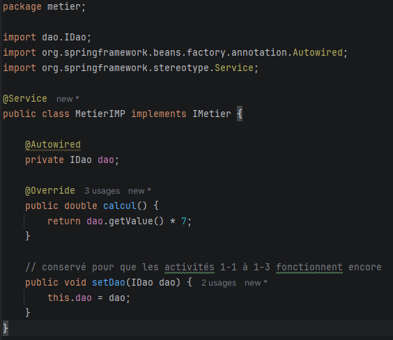

### Code : `presentation/PresentationAvecAnnotation.java`

```java
package presentation;

import metier.IMetier;
import org.springframework.context.ApplicationContext;
import org.springframework.context.annotation.AnnotationConfigApplicationContext;

public class PresentationAvecAnnotation {
    public static void main(String[] args) {
        // Scan des packages contenant les classes annotées
        ApplicationContext context =
                new AnnotationConfigApplicationContext("dao", "metier");

        IMetier metier = context.getBean(IMetier.class);
        System.out.println(metier.calcul());
    }
}
```

### Exécution

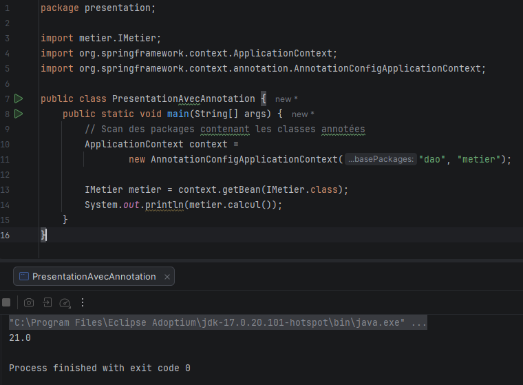

Résultat : `21.0`. Ici, `config.xml` n'est plus utilisé.

### Réponses aux questions

**Q5. Comment Spring gère-t-il l'injection de dépendances avec les annotations ?**

- `AnnotationConfigApplicationContext("dao", "metier")` scanne ces packages à la recherche de classes annotées par un stéréotype (`@Repository`, `@Service`, `@Component`, `@Controller`).
- Chaque classe trouvée devient un bean géré par Spring : `@Repository` marque la couche d'accès aux données, `@Service` la couche métier.
- `@Autowired` sur `private IDao dao` demande à Spring de chercher un bean compatible avec le type `IDao` (ici `DaoIMP`) et de l'injecter automatiquement.
- Il n'y a plus de XML ni de `setDao()` appelé explicitement : la configuration est portée par le code.
- Si plusieurs beans implémentent `IDao`, Spring signale une ambiguïté ; on la résout avec `@Qualifier` ou `@Primary`.

**Q6. Pourquoi cette solution est-elle plus maintenable que la configuration XML ? En quoi représente-t-elle une application complète du principe IoC ?**

*Maintenabilité :*
- La configuration se trouve à côté du code qu'elle concerne : plus de fichier XML séparé à tenir à jour.
- Pas de noms de classes écrits sous forme de chaînes de caractères : un renommage ou un déplacement de classe dans l'IDE ne casse plus la configuration.
- Le code est plus court et plus lisible : ajouter un composant revient à ajouter une annotation.
- Les erreurs (bean introuvable, ambiguïté) sont détectées dès le démarrage du conteneur.

*Application complète de l'IoC :*
Le conteneur découvre lui-même les composants (scan), les instancie, résout leurs dépendances et les injecte. Le code de présentation ne contient ni `new`, ni appel à `setDao()`, ni liste de beans : il demande simplement un `IMetier` au conteneur. Le programmeur déclare seulement le rôle de chaque classe, et tout le reste est assuré par Spring.

*Limite :* les classes dépendent maintenant des annotations Spring, alors que le XML laissait le code métier indépendant du framework.

---

## Tableau de synthèse

| Activité | Qui crée et assemble les objets ? | Mécanisme |
|---|---|---|
| 1-1 Statique | Le programmeur | `new` + `setDao()` |
| 1-2 Dynamique | Le programme, via la configuration | `config.txt` + `Class.forName()` |
| 1-3 Spring XML | Le conteneur Spring | `config.xml` (`<bean>`, `<property>`) |
| 1-4 Annotations | Le conteneur Spring | `@Repository`, `@Service`, `@Autowired` |

## À retenir

**Couplage faible** (dépendre d'interfaces) → **injection de dépendances** (recevoir sa dépendance de l'extérieur) → **inversion de contrôle** (un conteneur crée et assemble les objets).

## Exécuter le projet

1. Cloner le dépôt : `git clone https://github.com/DamakAmeni/TP1-IoC-DI.git`
2. Ouvrir le projet dans IntelliJ IDEA (JDK 17) et laisser Maven charger les dépendances.
3. Lancer l'une des classes du package `presentation` : chacune affiche `21.0`.